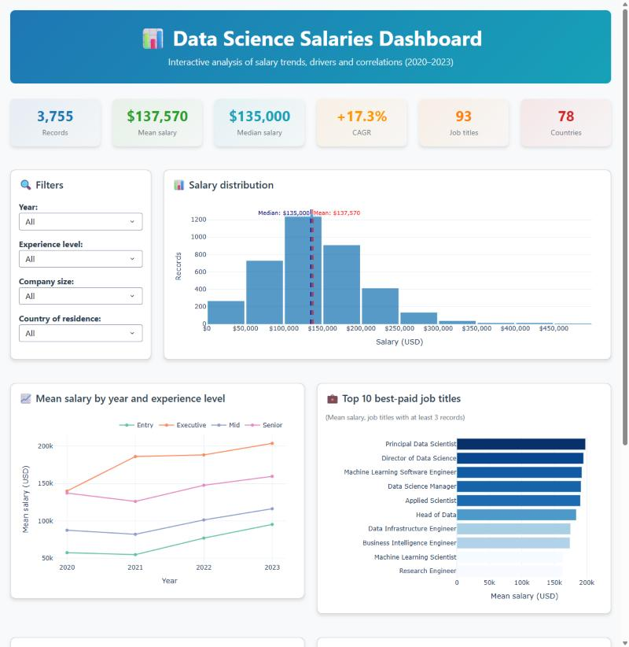

<div align="center">

# 📊 Statistical Analysis of Salaries in Data Science

**What drives pay in data roles: experience, company size, job title, country and time, with an interactive Plotly Dash dashboard**


[](https://colab.research.google.com/github/Laurentius96/Statistical_Analysis_of_Salaries_in_Data/blob/main/main.ipynb)

<p>
  <a href="#-overview">Overview</a> •
  <a href="#-dataset">Dataset</a> •
  <a href="#-key-findings">Findings</a> •
  <a href="#-salary-drivers">Drivers</a> •
  <a href="#-trends-2020-2023">Trends</a> •
  <a href="#-interactive-dashboard">Dashboard</a> •
  <a href="#-how-to-use">How to Use</a> •
  <a href="#-caveats">Caveats</a> •
  <a href="#-license">License</a>
</p>

</div>

---

## 🔍 Overview

How much does a data professional earn, and why? This project analyses **3,755 salary records (2020–2023)** to measure how experience level, company size, job title, country and year shape pay, and turns the results into a filterable **Plotly Dash dashboard** for HR teams and job seekers.

| | |
|---|---:|
| 💰 Mean / median salary | **$137,570 / $135,000** |
| 🎯 Executive vs. Entry level | **+148%** |
| 📈 Growth of the mean salary 2020→2023 | **CAGR +17.3%** |
| 🌍 Countries / job titles | 78 / 93 |

> Built as a DNC School Data Science challenge.

## 📊 Dataset

[`data/data_science_salaries.csv`](data/data_science_salaries.csv): the Data Science Salaries dataset from Kaggle, as adapted for the challenge. No missing values.

<details>
<summary><b>📖 Columns</b></summary>
<br>

| Column | Description |
|---|---|
| `work_year` | Year of the salary (2020–2023) |
| `country`, `region` | Country and region of the record |
| `experience_level` | EN (Entry), MI (Mid), SE (Senior), EX (Executive) |
| `job_title` | Role |
| `salary_in_usd` | Annual salary in USD |
| `employee_residence`, `company_location` | Country codes of the employee and of the company |
| `company_size` | S (small), M (medium), L (large) |
| `years_of_experience` | Derived from `experience_level` (see [caveats](#-caveats)) |

</details>

## 💡 Key Findings

| Topic | Finding |
|---|---|
| 🎯 Experience | The strongest driver: Entry **$78.5K** → Mid **$104.5K** (+33%) → Senior **$153.1K** (+46%) → Executive **$194.9K** (+27%) |
| 🏢 Company size | **Medium companies pay the most** (mean $143.1K), ahead of large ($118.3K) and small ($78.2K) |
| 👔 Roles | Data Engineer, Data Scientist and Data Analyst are **66% of the records** |
| 🥇 Best-paid roles | Principal Data Scientist ($198K), Director of Data Science ($195K), ML Software Engineer ($192K), among roles with at least 3 records |
| 📈 Trend | Mean salary rose from **$92.3K (2020) to $149.0K (2023)**; Entry level grew the most (+65.7%), Senior the least (+16.3%) |
| 🔗 Correlation | Experience level has the strongest link with salary (**r = 0.44**); company size alone shows none (r = 0.00) |
| 📊 Distribution | Half of the salaries are between $95K and $175K; 63 IQR outliers (1.7%), all above $295K |

## 🧭 Salary Drivers

<details open>
<summary><b>🎯 By experience level</b></summary>
<br>

| Level | Mean | Median | Records | vs. previous level |
|---|---:|---:|---:|---:|
| Entry | $78,546 | $70,000 | 320 | — |
| Mid | $104,526 | $100,000 | 805 | +33.1% |
| Senior | $153,051 | $146,000 | 2,516 | +46.4% |
| Executive | $194,931 | $196,000 | 114 | +27.4% |

</details>

<details>
<summary><b>🏢 By company size</b></summary>
<br>

| Size | Mean | Median | Records |
|---|---:|---:|---:|
| Small | $78,227 | $62,146 | 148 |
| Medium | $143,131 | $140,000 | 3,153 |
| Large | $118,301 | $108,500 | 454 |

</details>

<details>
<summary><b>👔 Top 10 best-paid roles (at least 3 records)</b></summary>
<br>

| Role | Mean | Median | Records |
|---|---:|---:|---:|
| Principal Data Scientist | $198,171 | $164,630 | 8 |
| Director of Data Science | $195,141 | $168,000 | 11 |
| Machine Learning Software Engineer | $192,420 | $181,800 | 10 |
| Data Science Manager | $191,279 | $183,780 | 58 |
| Applied Scientist | $190,264 | $191,738 | 58 |
| Head of Data | $183,858 | $202,500 | 10 |
| Data Infrastructure Engineer | $175,052 | $183,655 | 6 |
| Business Intelligence Engineer | $174,150 | $171,150 | 4 |
| Machine Learning Scientist | $163,220 | $167,875 | 26 |
| Research Engineer | $163,108 | $155,000 | 37 |

</details>

<details>
<summary><b>🌍 Top countries of residence (at least 5 records)</b></summary>
<br>

| Country | Mean | Median | Records |
|---|---:|---:|---:|
| PR (Puerto Rico) | $166,000 | $160,000 | 5 |
| US | $152,822 | $145,000 | 3,004 |
| CA | $132,223 | $120,000 | 85 |
| IE | $114,943 | $101,943 | 7 |
| JP | $103,538 | $74,000 | 7 |
| DE | $94,772 | $76,833 | 48 |
| GB | $86,988 | $80,036 | 167 |

</details>

## 📈 Trends 2020-2023

| Year | Mean | Median | Records | Growth |
|---|---:|---:|---:|---:|
| 2020 | $92,303 | $73,065 | 76 | — |
| 2021 | $94,087 | $80,000 | 230 | +1.9% |
| 2022 | $133,339 | $131,300 | 1,664 | +41.7% |
| 2023 | $149,046 | $143,860 | 1,785 | +11.8% |

**CAGR 2020→2023: +17.3%.** Growth by level: Entry +65.7%, Executive +45.6%, Mid +32.8%, Senior +16.3%.

## 💻 Interactive Dashboard

<div align="center">
  
</div>

[`salary_dashboard.py`](salary_dashboard.py) is a responsive Plotly Dash app with:
- **KPI cards:** records, mean and median salary, CAGR, job titles and countries
- **Filters:** year, experience level, company size and country of residence
- **Five linked charts:** salary distribution with mean and median, trend by experience level, top 10 best-paid roles, correlation matrix and mean salary by company size

## 📁 Project Structure

```
📁 Statistical_Analysis_of_Salaries_in_Data/
├── 📁 data/
│   └── 📄 data_science_salaries.csv   # 3,755 salary records
├── 📁 assets/
│   └── 🖼️ dashboard_preview.jpg
├── 📓 main.ipynb                      # Full analysis with outputs and charts
├── 🐍 salary_dashboard.py             # Plotly Dash dashboard
├── 📄 requirements.txt
├── 📄 LICENSE.md                      # CC BY-NC-ND 4.0
└── 📄 README.md
```

## 🚀 How to Use

1. **Clone and install**

   ```bash
   git clone https://github.com/Laurentius96/Statistical_Analysis_of_Salaries_in_Data.git
   cd Statistical_Analysis_of_Salaries_in_Data
   pip install -r requirements.txt
   ```

2. **Run the dashboard** and open http://127.0.0.1:8050

   ```bash
   python salary_dashboard.py
   ```

3. **Explore the analysis**

   ```bash
   jupyter notebook main.ipynb
   ```

> 💡 **In Google Colab:** run `!git clone https://github.com/Laurentius96/Statistical_Analysis_of_Salaries_in_Data.git` and `%cd Statistical_Analysis_of_Salaries_in_Data` in the first cell, then run the notebook.

## 🚧 Caveats

- **80% of the records are from US residents** and 92% are from 2022–2023, so global and early-year figures are less representative.
- **`years_of_experience` is derived from `experience_level`** (Entry 1–2, Mid 3–5, Senior 6–8, Executive 9–10), so its correlation with salary (r = 0.41) only mirrors the level.
- The comparison by company size does not control for country or level; it describes the sample, not a causal effect.

**Next steps**
- [ ] Compare salaries within the US only, removing the country effect
- [ ] Model salary with level, role, size and country together (regression with interactions)

## 🤝 Contributing

Contributions, ideas and feedback are welcome!

- 🐛 **Found a bug or something unclear?** [Open an issue](https://github.com/Laurentius96/Statistical_Analysis_of_Salaries_in_Data/issues/new) describing what happened and how to reproduce it.
- 💡 **Have an idea or a question?** [Open an issue](https://github.com/Laurentius96/Statistical_Analysis_of_Salaries_in_Data/issues/new) and tell me about it.
- 🔧 **Want to propose a fix?** Fork the repository, create a branch (`git checkout -b fix/short-description`), commit your changes and open a pull request explaining what changed and why.

By contributing, you agree that your contribution is shared under the same license as this project.

## 📜 License

This project is licensed under the [Creative Commons Attribution-NonCommercial-NoDerivatives 4.0 International License (CC BY-NC-ND 4.0)](LICENSE.md).

**What this means:**
- ✅ You may **share** this work with **attribution**
- ❌ You may **not** use it for **commercial purposes**
- ❌ You may **not** distribute **modified versions**

## 🙏 Acknowledgments

- [DNC School](https://www.escoladnc.com.br/) for the challenge
- The Data Science Salaries dataset on Kaggle

---

<div align="center">

**Lorenzo C. Bianchi** · [GitHub](https://github.com/Laurentius96) · [LinkedIn](https://www.linkedin.com/in/cb-lorenzo/)

</div>
